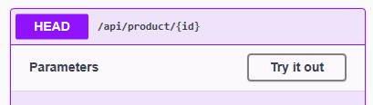

# 5. REST API with Web API Technology

You may earn **4 points** by completing this exercise.

Use GitHub Classroom to get your git repository. You can find the **invitation link in Moodle**. Clone the repository created via the link. It contains a skeleton and the expected structure of your submission. You need to create a branch, named `solution`, and **work on this branch**. After completing the exercises and verifying them, commit and push your submission.

The required software and tools for the solution can be found [here](../index.md#required-tools).

## Exercise 0: Neptun code

As a first step, enter your Neptun code into the `neptun.txt` file located in the root folder.

## Exercise 1: Simple query and OpenAPI documentation (2 points)

In the created and cloned repository, you'll find the initial code structure. Open it with Visual Studio and start the project. A console application should be started that hosts the web application. Try it out (while the program is running): open <http://localhost:5000/api/product> in your browser, where you should see the list of products in JSON format.

Check the available code.

- The `Program.cs` initializes the application. This is an ASP.NET Core web application.
- For simplicity, there is no database access in the application. The `ProductRepository` provides data to be used for testing.
- The `ProductsController` instantiates the `IProductRepository` using _dependency injection_.

Tasks:

### Simple Query

1. In the `DAL.ProductRepository` class, replace the value of the field named `Neptun` with your Neptun code. The string value should consist of 6 characters from your Neptun code.

    !!! warning "IMPORTANT"
        A screenshot must be taken of the modified data, so this step is important.

1. Create an API endpoint to check if a product with a given id exists. We will send a `HEAD` HTTP request to the `/api/product/{id}` URL for the query. The response should be HTTP 200 or 404 (without any extra content/body, only the response code is required).

### OpenAPI Documentation

OpenAPI (formerly known as Swagger) is a documentation tool for REST APIs. Its purpose is similar to that of WSDL used for Web Services: to describe the API services in a standardized format. After completing the previous tasks, create an [OpenAPI specification and documentation](https://learn.microsoft.com/en-us/aspnet/core/tutorials/web-api-help-pages-using-swagger) for the REST API description.

1. To complete the solution, follow the official Microsoft documentation: <https://learn.microsoft.com/en-us/aspnet/core/tutorials/getting-started-with-swashbuckle>, and the Swashbuckle project's own documentation: <https://github.com/domaindrivendev/Swashbuckle.AspNetCore>

    - Make sure to use the **Swashbuckle** option (`Swashbuckle.AspNetCore` NuGet package).

        !!! warning "Built-in OpenAPI support"
            Since .NET 9, the ASP.NET Core project templates no longer include Swashbuckle; built-in OpenAPI support is available instead (`AddOpenApi()` / `MapOpenApi()`). **Do not** use it: the built-in solution serves the document at `/openapi/v1.json` and provides no Swagger UI, while the automated evaluation expects the addresses given below. Setting up Swashbuckle (`AddSwaggerGen`, `UseSwagger`, `UseSwaggerUI`) works on .NET 10 as described in the documentation.

    - The `swagger.json` should be generated by the application itself (you don't need to write it manually), and it should be accessible at `/swagger/v1/swagger.json`.
    - Also set up the _Swagger UI_, which should be accessible at `/neptun`. You can achieve this by configuring the `RoutePrefix` in the `UseSwaggerUI` setup. Your Neptun code should be the prefix **in all lowercase**.
    - We need to use swagger components **not only** in Development mode.
    - (You do not need to deal with the "Customize and extend" section or other customizations.)

1. Start the web application and check the `swagger.json` at <http://localhost:5000/swagger/v1/swagger.json>, and try out the SwaggerUI at <http://localhost:5000/neptun>.

1. Test the "Try it out" feature of SwaggerUI: it actually sends the request to the web application, and you can see the real response.

    

1. Create the API endpoint that returns the desired product (`Product`) based on its ID; the request should be of type `GET` to the `/api/product/{id}` URL, and the response should either be 200 with the data or 404 if no such item exists. Verify this using SwaggerUI.

!!! example "SUBMISSION"
    Upload the modified source code. Make sure to note that the `csproj` file has also been modified with the added NuGet package!

    Take a screenshot of the Swagger UI displayed in the browser. Ensure that the URL shows that the SwaggerUI is served at the `/neptun` path with your own Neptun code. Save the image as `f1.png` and submit it as part of your solution!

## Exercise 2: Product Operations (2 points)

The most common database operations related to products are inserting a new one, querying an existing product, modifying it, or deleting it, which are the CRUD (create, read, update, and delete) operations. We will create dedicated endpoints for these operations, allowing the API user to perform them. In this task, you need to implement the most common endpoints alongside the existing query.

1. Create an API endpoint that inserts a new product (`Product`); the request should be of type `POST` to the `/api/product` address, expecting the new `Product` value in the request body, and the response should be either 201 or 409 if such an item with the given name already exists.

1. Create an API endpoint that modifies a product (`Product`) based on its ID; the request should be of type `PUT` to the `/api/product/{id}` address, expecting the modified `Product` value in the request body, and the response should be either 204 with no content or 404 if such an item does not exist.

1. Create an API endpoint that deletes a product (`Product`) based on its ID; the request should be of type `DELETE` to the `/api/product/{id}` address, and the response should be either 204 with no content or 404 if such an item does not exist.

1. Create an API endpoint that allows querying how many different products there are in total. (For example, to facilitate pagination, the frontend can calculate how many pages there will be.) This should also be a `GET` type request to the `/api/product/-/count` address. The returned data should be an instance of the `CountResult` class filled with the total count (in JSON format, of course).

    ??? question "Why is there a `/-` part in the URL?"
        To understand this, let's consider what the URL could be: we are curious about the number of products, so it could be `/api/product/`, but what comes after? It could be `/api/product/count`. However, this "conflicts" with URLs like `/api/product/123`, which is intended for querying a specific product. In practice, the two URLs could work together, because the product identifier is currently a number, so the framework recognizes that if the URL ends with `/123`, it needs to execute the endpoint expecting a product ID, but if it ends with `/count`, it should provide the count. But this only works if the ID is an integer. If the product identifier were text, there would be a problem. In such cases, a URL needs to be "invented" that does not collide. The `/-` part indicates that there is _not_ a product ID traveling there.

        Note: The URL - controller method identification is more complex in reality than described above. The ASP.NET Core framework matches controller methods to incoming request URLs in order of priority. We have the ability to influence this priority using the [`[Http*]` attributes `Order` property](https://learn.microsoft.com/en-us/dotnet/api/microsoft.aspnetcore.mvc.httpgetattribute).

!!! example "SUBMISSION"
    Upload the modified source code.

    Additionally, take a screenshot of the Visual Studio `.http` file and the response pane (or of another testing tool, e.g. Postman) showing the result of a successful product retrieval. The image should display all details of the request and response (request type, URL, response code, response content). Your **Neptun code** must appear in the response. Save the image as `f2.png` and submit it as part of your solution!

!!! danger "YOU HAVE NOT FINISHED YET"
    After pushing your code to the `solution` branch, create a PR and assign your lab instructor to it! (more details: on the [assignment submission](../GitHub.md) page)

## Exercise 3 optional: Partial Update of Product (0 points)

When modifying products, the previously used `PUT` call has several disadvantages. `PUT` is designed for updating the entire resource, meaning that to modify a product, the entire product must be sent. This is not only inefficient (for example, it requires retrieving and sending every existing property, regardless of their size) but also adds extra processing tasks. The `PATCH` verb is designed to provide partial update capabilities, allowing only the properties that need to be modified to be sent.

In this task, you need to create an endpoint that allows for partial updates of products:

1. The request should be of type `PATCH` to the `/api/product/{id}` URL, and the response should either be 204 if successful, or 404 if the item does not exist.

1. Implement the endpoint in the `ProductsController` class that performs the partial update. The type of the parameter received by the endpoint should be a strongly typed variant of `JsonPatchDocument`. During testing, ensure that only the values sent are changed (for example, if the sent object does not include stock, that should not change).

!!! tip "JsonPatchDocument in .NET 10"
    Starting with .NET 10, JSON Patch support is based on System.Text.Json: add the [`Microsoft.AspNetCore.JsonPatch.SystemTextJson`](https://www.nuget.org/packages/Microsoft.AspNetCore.JsonPatch.SystemTextJson) NuGet package to the project; the `JsonPatchDocument<T>` class is in the `Microsoft.AspNetCore.JsonPatch.SystemTextJson` namespace. Details: [JSON Patch in ASP.NET Core web API](https://learn.microsoft.com/en-us/aspnet/core/web-api/jsonpatch?view=aspnetcore-10.0).

    The older, Newtonsoft.Json-based solution (the `Microsoft.AspNetCore.Mvc.NewtonsoftJson` package and `AddNewtonsoftJson()`) is also accepted, but it replaces the JSON handling of the whole application, not only for PATCH requests.

!!! warning "Content-Type: `application/json-patch+json`"
    The standard media type of JSON Patch requests is `application/json-patch+json`, and the System.Text.Json-based `JsonPatchDocument` only accepts this one: if you send the request with a plain `application/json` header, you get a `415 Unsupported Media Type` response. The automated evaluation also sends the request with this header. The body is a list of patch operations, for example in the `.http` file:

    ```http
    PATCH http://localhost:5000/api/product/1
    Content-Type: application/json-patch+json

    [
        { "op": "replace", "path": "/Name", "value": "NEPTUN new name" }
    ]
    ```

!!! example "SUBMISSION"
    Upload the modified source code.

    Additionally, take a screenshot of the Visual Studio `.http` file and the response pane (or of another testing tool, e.g. Postman) showing the result of a successful partial modification. The image should display all details of the request (request type, URL, `Content-Type` header, request body) and the response code (`204 No Content`). Your **Neptun code** must appear in the new name in the request body. Save the image as `f3.png` and submit it as part of your solution!


